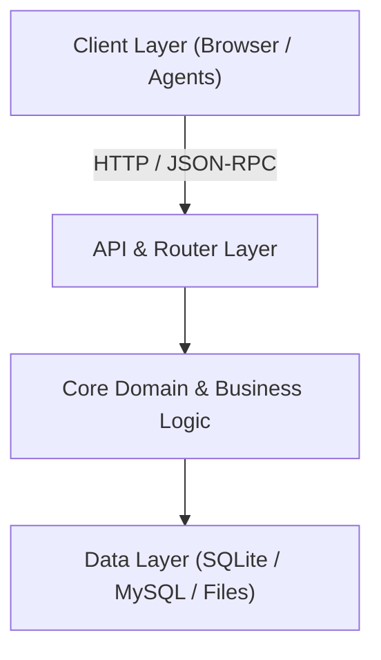
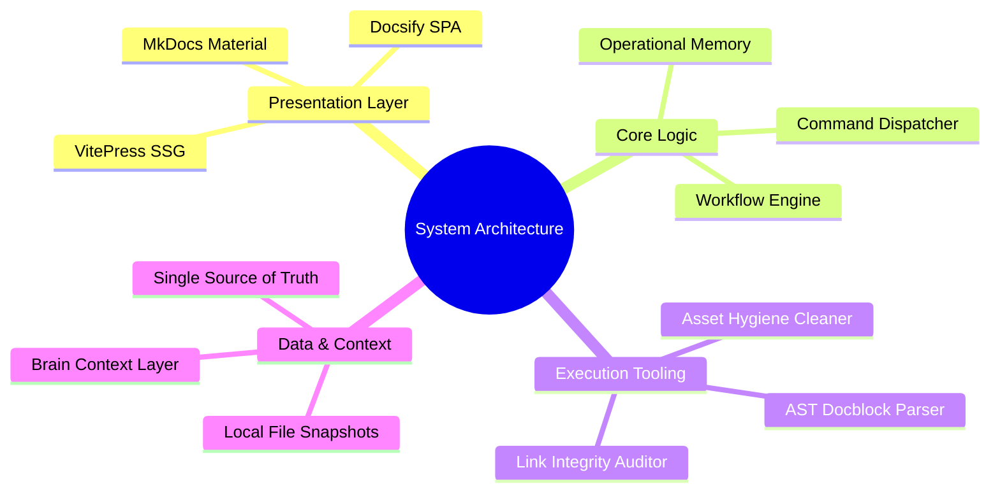
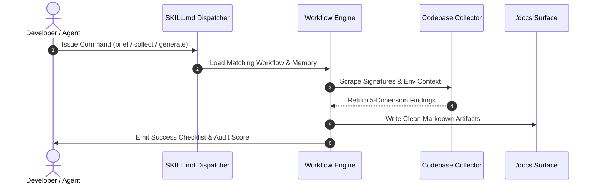

<!-- last-verified: 2026-09-09 -->
# Memory: project-mindmap

Codified guidelines and Mermaid AST templates for generating clear, interactive architectural mind maps and component topology diagrams in documentation.

## 1. Top-Level Architectural Layering (Mermaid C4 / Graph)

## 2. Component Topology & Responsibility Mind Map

## 3. Data Flow & Execution Sequence Diagram

## 4. Usage Guidelines

1. Place overarching mind maps in `docs/README.md` or `docs/guides/architecture.md`.
2. Do not use raw image screenshots when Mermaid diagrams can represent topology directly in text.
3. Keep node labels concise (≤ 4 words) to maintain high readability across mobile and desktop viewports.
